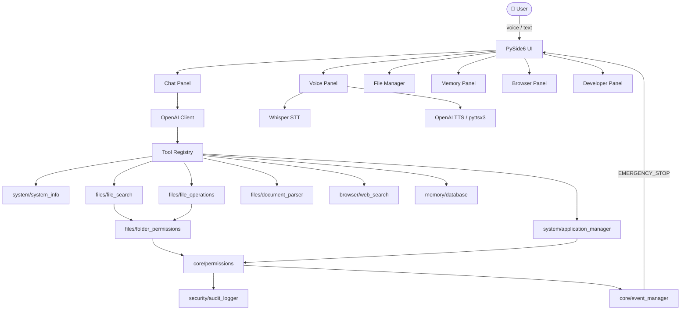

# JARVIS — Advanced Personal AI Laptop Assistant

> A modular, production-minded desktop AI assistant for Windows 10/11 built with Python, PySide6, and OpenAI.

---

## Table of Contents

1. [Features](#features)
2. [Project Structure](#project-structure)
3. [Installation](#installation)
4. [Configuration](#configuration)
5. [Running JARVIS](#running-jarvis)
6. [Running Tests](#running-tests)
7. [Tabs & Panels](#tabs--panels)
8. [Permission System](#permission-system)
9. [Adding New Tools](#adding-new-tools)
10. [Adding Languages](#adding-languages)
11. [Architecture](#architecture)
12. [Security Notes](#security-notes)
13. [Packaging](#packaging)
14. [Troubleshooting](#troubleshooting)

---

## Features

| Category | Capability |
|----------|-----------|
| 💬 **AI Chat** | Streams OpenAI responses; tool-calling; conversation memory |
| 🎙 **Voice** | Whisper STT; OpenAI TTS with pyttsx3 fallback; English/Telugu/Hindi |
| 🖥 **System Monitor** | Live CPU, RAM, disk, battery, network, processes via psutil |
| 📱 **App Manager** | List, launch, and close Windows applications |
| 📁 **File Manager** | Search, copy, move, rename, delete within authorized folders |
| 📄 **Document Parser** | Read TXT, PDF, DOCX, CSV, JSON, XLSX, Markdown, source files |
| 🌐 **Web Assistant** | DuckDuckGo search; page-content reader; no cookies/auth |
| 🧠 **Memory** | SQLite-backed conversation history, notes, preferences, tasks |
| 👨‍💻 **Developer** | Project scanner (Python/Node/React/FastAPI); lint; Git status |
| ⚙ **Automation** | Natural-language plan → step-by-step executor with approval |
| 🔐 **Security** | Folder allowlist; permission levels; audit log; emergency stop |

---

## Project Structure

```
JARVIS/
├── main.py                  # Entry point
├── app/
│   ├── config.py            # Settings (env vars, paths, authorized folders)
│   └── startup.py           # Pre-flight diagnostics
├── ai/
│   └── openai_client.py     # OpenAI API client (chat + tool-calling)
├── voice/
│   ├── microphone.py        # Mic capture → WAV
│   ├── speech_to_text.py    # Whisper STT wrapper
│   ├── text_to_speech.py    # OpenAI TTS + pyttsx3 fallback
│   └── language_manager.py  # EN / TE / HI language maps
├── system/
│   ├── application_manager.py  # List, launch, terminate apps
│   └── system_info.py          # psutil hardware telemetry
├── files/
│   ├── folder_permissions.py   # Authorized-folder allowlist
│   ├── file_search.py          # Recursive file search
│   ├── file_operations.py      # Safe copy, move, rename, delete, create
│   └── document_parser.py      # TXT/PDF/DOCX/CSV/JSON/XLSX parsers
├── memory/
│   └── database.py          # SQLite: conversations, notes, prefs, tasks
├── browser/
│   └── web_search.py        # DuckDuckGo search + page reader
├── developer/
│   └── project_scanner.py   # Detect Python/Node/React projects; lint
├── automation/
│   └── engine.py            # Plan → approve → execute workflow engine
├── security/
│   └── audit_logger.py      # Structured audit log
├── core/
│   ├── permissions.py       # Permission manager (READ/CONTROL/ADVANCED)
│   └── event_manager.py     # Event bus (EMERGENCY_STOP, etc.)
├── ui/
│   ├── main_window.py       # Root window; all tabs
│   ├── dashboard.py         # Live system telemetry dashboard
│   ├── chat_panel.py        # AI conversation interface
│   ├── file_manager.py      # File manager tab
│   ├── memory_panel.py      # Memory manager tab
│   ├── browser_panel.py     # Web assistant tab
│   ├── developer_panel.py   # Developer assistant tab
│   └── components/
│       ├── metric_card.py      # Reusable stat card widget
│       └── permission_dialog.py # Confirmation dialog for risky actions
├── tests/
│   ├── test_config.py
│   ├── test_permissions.py
│   └── test_file_management.py
├── data/                    # Runtime data (SQLite DB, temp audio)
├── logs/                    # Audit logs
├── requirements.txt
├── .env.example
└── pytest.ini
```

---

## Installation

### Prerequisites
- Windows 10 or 11
- Python 3.10+ ([python.org](https://www.python.org/downloads/))
- Git (optional, for Git status in Dev panel)

### Steps

```powershell
# 1. Clone or download the project
cd "C:\Users\YourName\Desktop\JARVIS"

# 2. Create a virtual environment
python -m venv venv
venv\Scripts\activate

# 3. Install dependencies
python -m pip install -r requirements.txt
```

> **If pip.exe is blocked by AppLocker**, always use `python -m pip` instead of `pip` directly.

---

## Configuration

Copy the example file and edit it:

```powershell
copy .env.example .env
notepad .env
```

| Variable | Default | Description |
|----------|---------|-------------|
| `OPENAI_API_KEY` | _(empty)_ | Your OpenAI API key. Without it, JARVIS runs in offline mode. |
| `OPENAI_MODEL` | `gpt-4o-mini` | Chat model. Change to `gpt-4o` for better quality. |
| `OPENAI_TTS_VOICE` | `onyx` | Voice: `alloy`, `echo`, `fable`, `onyx`, `nova`, `shimmer` |
| `JARVIS_LANGUAGE` | `en` | Default language: `en`, `te`, `hi`, or `auto` |
| `JARVIS_AUTHORIZED_FOLDERS` | _(project root)_ | Semicolon-separated list of folders JARVIS can access |
| `JARVIS_REQUIRE_CONFIRMATION` | `true` | Require user approval for CONTROL-level actions |
| `JARVIS_WAKE_WORD_ENABLED` | `false` | Enable always-on wake-word detection |

### Authorizing additional folders

```
JARVIS_AUTHORIZED_FOLDERS=C:\Users\YourName\Documents;C:\Projects
```

---

## Running JARVIS

```powershell
venv\Scripts\activate
python main.py
```

The window opens in ~3–5 seconds with all tabs.

---

## Running Tests

```powershell
python -m pytest -v
```

Expected: **27 tests passing**.

Run only file-management tests:
```powershell
python -m pytest tests/test_file_management.py -v
```

---

## Tabs & Panels

| Tab | Description |
|-----|-------------|
| 🖥 **Dashboard** | Live CPU, RAM, disk, battery, uptime — refreshes every 2.5 s |
| 💬 **Chat** | Type or speak to JARVIS; streams AI responses |
| 📁 **Files** | Search files by name or extension; copy/move/rename/delete |
| 🧠 **Memory** | View conversation history, add notes, see preferences & tasks |
| 🌐 **Browser** | Web search (DuckDuckGo) + read any webpage's text content |
| 👨‍💻 **Dev** | Scan for projects, run lint, check git status |

**Emergency Stop** button is always visible in the status bar at the bottom.

---

## Permission System

Every action is classified into one of three levels:

| Level | Examples | Requires confirmation? |
|-------|---------|----------------------|
| `READ` | System info, file search, list apps | No |
| `CONTROL` | Launch/close apps, copy/move files | Yes (dialog) |
| `ADVANCED` | Delete files, overwrite files | Yes (dialog with warning) |

All file operations are additionally restricted to the **authorized folders list** defined in `.env`. Any path outside the list is rejected with a `PermissionError`.

---

## Adding New Tools

1. Create your backend function in the appropriate package (`system/`, `files/`, `browser/`, etc.).
2. Register the tool in `ai/openai_client.py` following the existing tool-schema pattern.
3. Add the tool's execution case in the `AutomationEngine._call_tool` method in `automation/engine.py` (optional, for automation support).
4. Add unit tests in `tests/`.

---

## Adding Languages

1. Add the language code and voice mapping in `voice/language_manager.py`.
2. Update `JARVIS_LANGUAGE` in `.env` or choose the language in the Voice panel.
3. The OpenAI Whisper model auto-detects most languages; for TTS, choose a supported voice.

Currently tested: **English** (`en`), **Telugu** (`te`), **Hindi** (`hi`).

---

## Architecture



---

## Security Notes

- **No arbitrary shell execution**: The AI never runs raw shell commands. All actions go through typed, validated tool functions.
- **Folder allowlist**: File operations are restricted to `JARVIS_AUTHORIZED_FOLDERS`. Paths outside are rejected.
- **No credential storage**: JARVIS never saves API keys, passwords, browser cookies, or private keys.
- **Confirmation dialogs**: All `CONTROL` and `ADVANCED` actions require explicit user approval before proceeding.
- **Emergency stop**: The 🛑 button in the status bar immediately halts all ongoing operations.
- **Audit log**: Every action is logged to `logs/jarvis_audit.log` with timestamp, user, action, and result.

---

## Packaging

> Requires PyInstaller: `python -m pip install pyinstaller`

```powershell
pyinstaller --onedir --windowed --name JARVIS --add-data "data;data" --add-data "logs;logs" main.py
```

The bundled app will be in `dist/JARVIS/JARVIS.exe`.

---

## Troubleshooting

| Problem | Fix |
|---------|-----|
| `pip.exe` or `pytest.exe` blocked | Use `python -m pip` and `python -m pytest` |
| Window doesn't open | Wait 10 s; check terminal for errors |
| `ModuleNotFoundError` | Run `python -m pip install -r requirements.txt` |
| OpenAI errors | Check `.env` has correct `OPENAI_API_KEY` |
| Microphone not working | Allow mic in Windows Settings → Privacy → Microphone |
| File operation denied | Add the folder to `JARVIS_AUTHORIZED_FOLDERS` in `.env` |
| `No module named 'fitz'` | Run `python -m pip install pymupdf` |
| `No module named 'docx'` | Run `python -m pip install python-docx` |
